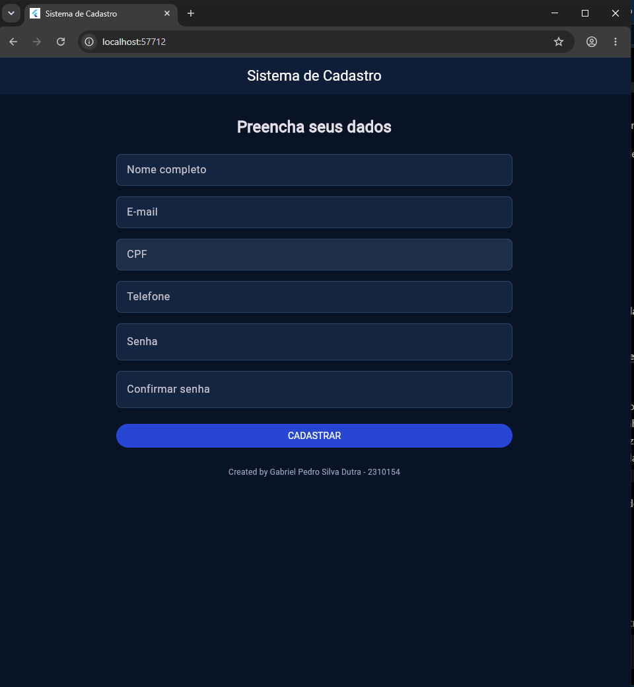
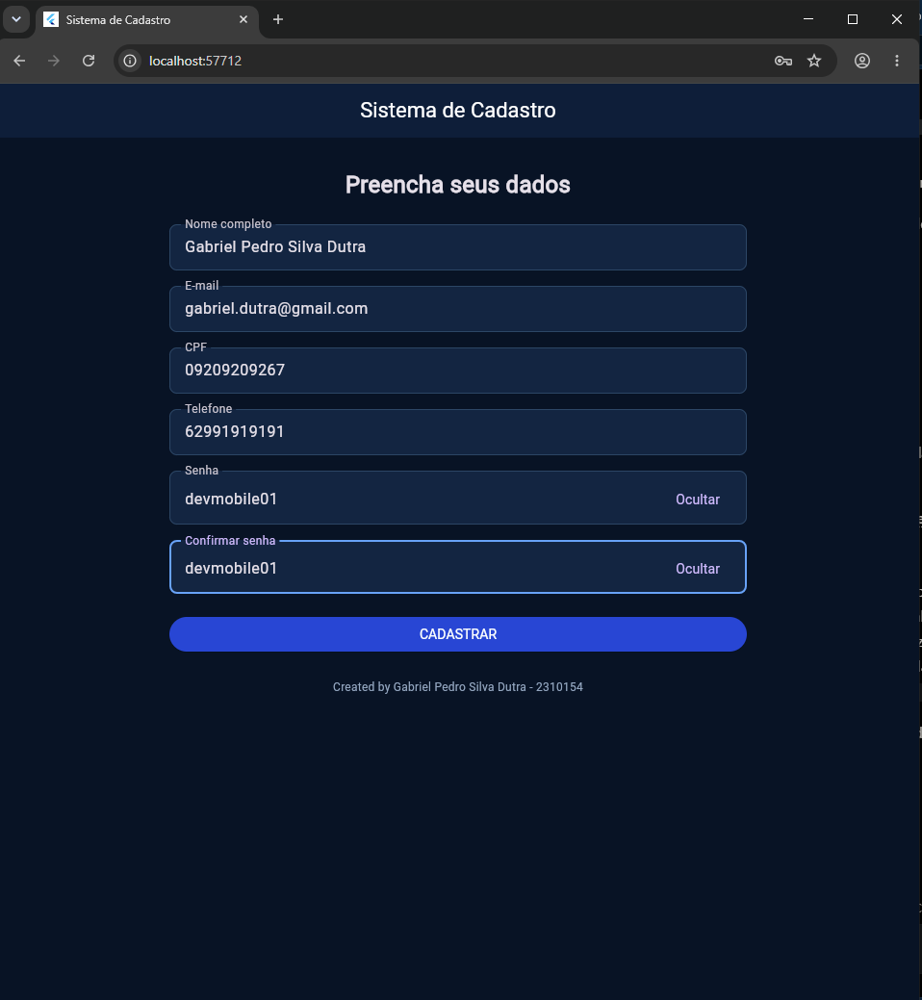
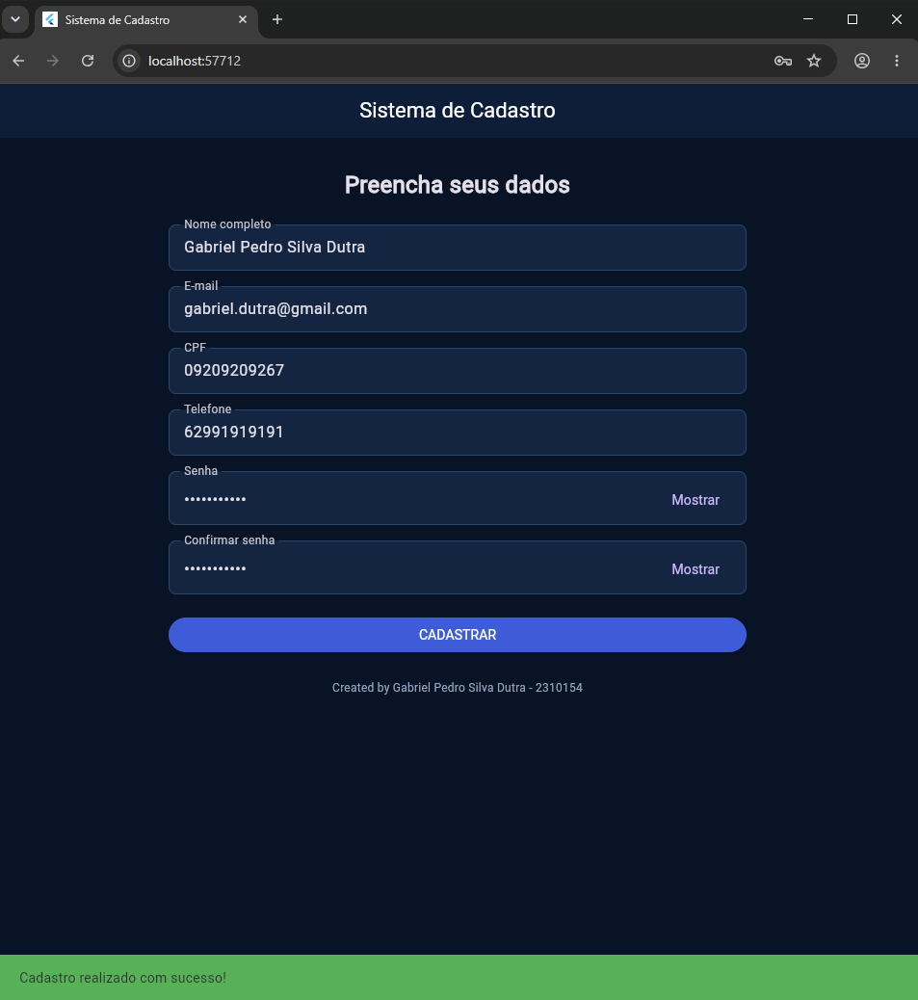

# Sistema de Cadastro — Flutter

Aplicativo desenvolvido em Flutter e Dart para a atividade prática de Desenvolvimento Mobile, com foco em formulários e validações.

## Sobre o projeto

O sistema permite preencher um formulário de cadastro de usuário, validando as informações digitadas e exibindo mensagens de orientação quando algum campo estiver incorreto.

## Telas do sistema

### Tela 1 — Cadastro de usuário



### Tela 2 — Validação dos campos



### Tela 3 — Resultado do cadastro



## Funcionalidades implementadas

- Campo de nome completo obrigatório.
- Campo de e-mail com validação usando `RegExp`.
- CPF e telefone aceitando somente números.
- Senha com no mínimo 6 caracteres.
- Confirmação de senha.
- Opções para mostrar ou ocultar as senhas.
- Mensagens de erro abaixo de cada campo inválido.
- `SnackBar` vermelho quando existem erros e verde quando o cadastro é válido.
- Formulário dentro de `SingleChildScrollView` para evitar problemas de espaço quando o teclado aparece.
- Interface com tema dark blue e layout simples.

## Tecnologias utilizadas

- **Flutter:** framework para desenvolvimento da interface.
- **Dart:** linguagem de programação utilizada no projeto.

## Como executar

Com o Flutter instalado, abra o terminal na pasta do projeto e execute:

```bash
flutter create .
flutter pub get
flutter run
```

O comando `flutter create .` cria os arquivos de plataforma que estiverem faltando, como os necessários para Android e Windows.

Para executar a versão web no Google Chrome, utilize:

```bash
flutter run -d chrome
```

## Observação

Este exercício realiza validações na tela. O cadastro ainda não é armazenado em banco de dados nem enviado para uma API.

## Autor

**Gabriel Pedro Silva Dutra — 2310154**

Desenvolvido para a disciplina de Desenvolvimento Mobile — Flutter e Dart.
